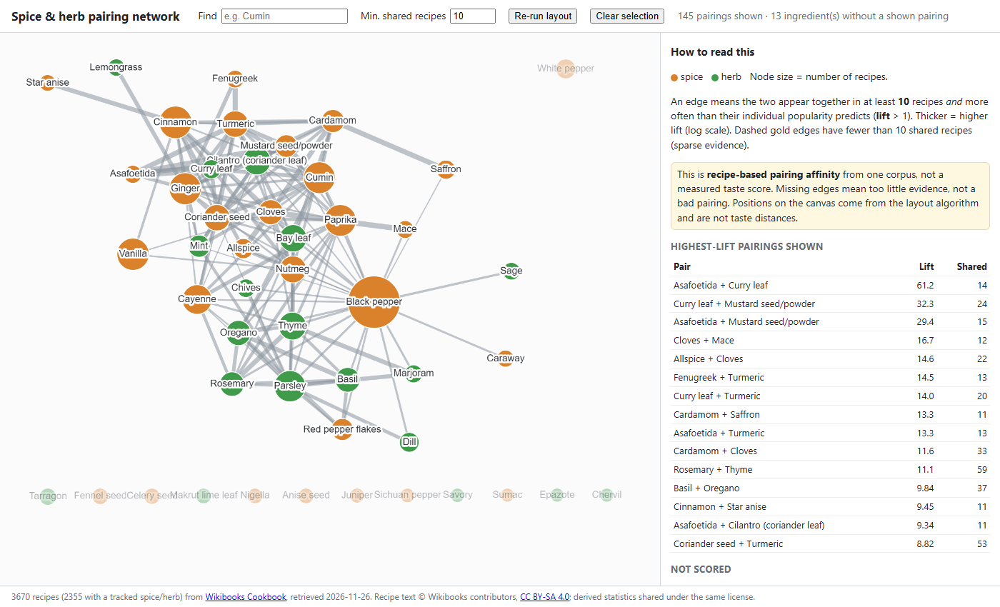

# Spice, herb & aromatic pairing network

An interactive network of how often spices, culinary herbs and aromatics appear together in recipes, scored by how much **more** often they co-occur than their individual popularity would predict.



## Quick start

```powershell
python fetch_wikibooks.py      # download Wikibooks recipes and cuisine categories (cached in data/raw/, git-ignored)
python data_pipeline.py        # parse, normalize, score -> web/data/pairings.json + .js, data/audit.json
start web\index.html           # open in a browser (works from file://, no server needed)
```

Only the Python standard library is required. Cytoscape.js is vendored in `web/vendor/`. The generated data is committed, so you can open `web/index.html` without re-running the pipeline.

Tests:

```powershell
python -m unittest discover -s tests
node --test tests/
```

## Host on GitHub Pages

This app is compatible with [GitHub Pages](https://docs.github.com/en/pages/getting-started-with-github-pages/what-is-github-pages): it serves static HTML, CSS, JavaScript and data, and the interactive network runs in the visitor's browser. The Python scripts are an offline data-preparation step, not a backend. No build tool or server is needed for deployment.

The workflow in `.github/workflows/deploy-pages.yml` publishes **only `web/`**, with `index.html` at the site's root. Relative script paths already work under the project URL. Local `file://` usage remains unchanged.

### First deployment

1. **Review before going public.** GitHub Free requires a public repository for Pages. Review tracked files **and Git history** for credentials, private material and permission to publish. Making the repository public exposes more than the website: for example, the tracked `data/audit.json` is readable in the repository even though it is not deployed. Ignore rules do not remove previously committed files; rotate any exposed credentials and address their history before publishing.
2. Once that review is complete, open the repository's **Settings > General > Danger Zone > Change repository visibility**, choose **public**, and follow GitHub's confirmation prompts. Alternatively, an eligible paid GitHub plan can use a private repository, but the Pages site and its deployed data are still public.
3. Open **Settings > Pages**. Under **Build and deployment**, set **Source** to **GitHub Actions**. If Actions is disabled, enable it under **Settings > Actions > General**, allowing the official actions used by this workflow.
4. Merge or push the deployment workflow onto **`main`**. Each push to `main` deploys the committed site. If that push happened before Pages was configured, open **Actions > Deploy to GitHub Pages > Run workflow**, select **`main`**, and run it. Runs on other branches do not deploy.
5. Watch the run in **Actions**. A *workflow* is the automated instruction file; the *artifact* is the packaged `web/` folder; *deployment* publishes that package to Pages. There is no recipe download or Python execution in this workflow.
6. After a successful run, open **Settings > Pages > Visit site**. The expected default address is [https://scienceguy128.github.io/spice-pairings/](https://scienceguy128.github.io/spice-pairings/); use the URL GitHub reports as authoritative. Check that the network, cuisine filter, ingredient search, pair details and source links work.

Keep the Wikibooks attribution in the page footer and the vendored Cytoscape license when publishing. Do not put secrets or private data in `web/`: visitors can download its files.

### Updates and troubleshooting

For UI updates, change files in `web/` and merge or push to `main`. For data updates, run the Python commands in Quick start locally, review and commit the regenerated `web/data/` files, then merge or push to `main`. Publishing uses that committed snapshot; it does **not** refresh recipes automatically.

- **Pages settings unavailable:** check repository visibility, account-plan eligibility and your repository permissions.
- **Deployment failed:** open the failing step in Actions. Check that Pages uses GitHub Actions, the required actions are allowed, and the `github-pages` environment permits deployment from `main`. The workflow requests `contents: read`, `pages: write` and `id-token: write`.
- **404 at the site:** confirm the deployment succeeded and use the exact URL shown in Settings > Pages, including `/spice-pairings/`.
- **Page loads but graph is missing:** check browser developer tools for failed script requests or console errors. Ensure all files under `web/` were committed; hosted filenames are case-sensitive.

For details, see GitHub's [site creation guide](https://docs.github.com/en/pages/getting-started-with-github-pages/creating-a-github-pages-site) and [custom Pages workflows](https://docs.github.com/en/pages/getting-started-with-github-pages/using-custom-workflows-with-github-pages).

## How the score works

For every pair of tracked ingredients, over **N** deduplicated recipes in the current selection:

```
lift = (recipes with both × N) / (recipes with A × recipes with B)
```

- **lift > 1**: used together more often than chance given how common each one is.
- **lift ≈ 1**: no association beyond popularity.
- **lift < 1**: used together less than expected *in this corpus* — not proof they clash.

Raw co-occurrence counts would mostly show that black pepper and parsley are common. Lift corrects for that, but it can overrate rare pairs, so every pair also shows the number of shared recipes.

### What the network shows

- **Nodes**: one per spice (orange), herb (green) or aromatic (purple); size reflects the number of recipes containing it.
- **Edges**: pairs with at least *k* shared recipes **and** lift > 1. Width is scaled log-lift. For all cuisines, *k* defaults to **10** and can be changed in the header. Pairs with fewer than 10 shared recipes are drawn dashed (sparse evidence).
- **Cuisine** filters the network, counts, lift scores and examples to recipes in that Wikibooks origin category, including its subcategories. A recipe can belong to more than one cuisine; recipes without an origin category are excluded from cuisine views but remain in the all-cuisine view. Because cuisine samples are often small, the initial minimum is **2** shared recipes when that yields a positive pair, or **1** otherwise. A manually chosen minimum is retained when changing cuisines.
- **Click an ingredient** to see its strongest supported partners, observed pairs that aren't drawn (below threshold or no positive association), and ingredients never seen with it.
- **Click an edge or row** to see lift, counts, expected co-occurrence and links to example recipes.

Network positions are produced by a force layout and are not a taste distance.

## Data pipeline

1. `fetch_wikibooks.py` uses the official MediaWiki API to download every page in `Category:Recipes` (the Cookbook namespace), with revision IDs and retrieval time. It also caches the ancestry of recipe-origin categories. It backs off on rate limits. For an older recipe cache, or if category retrieval fails, run `python fetch_wikibooks.py --categories-only` to refresh just the category data.
2. `data_pipeline.py`:
   - extracts bullet lines under `Ingredients` headings (including subsections); pages with fewer than 2 such lines are skipped;
   - strips wiki markup and matches the rules in `ingredient_aliases.json` in order;
   - keeps cilantro (leaf) separate from coriander seed, and black, white, Sichuan pepper, cayenne and red pepper flakes separate; ambiguous bare "coriander" or "pepper" (e.g. "1 pepper, sliced") is excluded and logged;
   - includes garlic, onion, shallot, scallion (spring/green onion), leek, celery, fennel bulb and galangal as aromatics; garlic/onion powders share their fresh ingredient's ID, while chives, ginger and lemongrass retain their existing herb/spice categories;
   - recognizes garlic "cloves" as garlic, not the clove spice; keeps celery/fennel seeds and nigella ("black onion seed") separate from the vegetables;
   - ignores garlic bread, onion soup mix, ginger ale, Dijon/prepared mustard, dill pickles, etc.; garlic/onion/celery salts are counted as blends, not individual ingredients;
   - does **not** split blends (curry powder, garam masala, chili powder, Italian seasoning, …) into components — they are counted and reported separately;
   - excludes lines that offer alternatives ("thyme or oregano") from pair evidence;
   - counts each ingredient once per recipe;
   - removes duplicate recipes (identical ingredient sections, or same base title with the same tracked ingredient set);
   - classifies recipes by their explicit Wikibooks recipe-origin categories and their origin ancestors; duplicate recipes retain all their cuisine categories;
   - keeps recipes without any tracked ingredient in the denominator N, both overall and within each cuisine.
3. `data/audit.json` lists ambiguous lines, excluded alternatives, removed duplicates and a random sample of 200 parsed lines for manual review.

## Current results (retrieved 2026-11-26)

- 3,802 recipe pages downloaded; 112 without a usable ingredient list and 19 duplicates removed → **N = 3,671** recipes, 2,634 containing at least one of the 56 tracked spices/herbs/aromatics.
- 861 pairs observed together at least once; **231** meet the default filter (≥ 10 shared recipes, lift > 1).
- Aromatic coverage: onion (1,077 recipes), garlic (936), celery (142), scallion (142), shallot (60), leek (31), fennel bulb (8) and galangal (7). Garlic + onion share 551 recipes, with lift **2.01×**.
- Strong clusters: Indian tempering (asafoetida, curry leaf, mustard seed, turmeric, fenugreek), warm baking/sweet spices (cloves, mace, allspice, cardamom, saffron, cinnamon, star anise) and Mediterranean herbs (rosemary + thyme 11.1×, basil + oregano 9.8×).
- Black pepper is in 32% of recipes, so its raw ingredient count is the largest. Edges with lift close to 1 should be treated as weak.
- Thin coverage (< 10 recipes): fennel bulb, galangal, anise seed, makrut lime leaf, nigella, juniper, Sichuan pepper, savory, chervil, epazote, sumac. They appear faded until you lower the threshold.
- Blends were counted but not scored: chili powder (139), curry powder (58), garam masala (34), berbere (24), garlic salt (14), …

## Limitations

- One community-written corpus of a few thousand recipes; coverage skews toward cuisines Wikibooks contributors wrote about, and rare ingredients have little evidence.
- Cuisine categories are incomplete and may overlap; small cuisine subsets and one-recipe pairings are especially uncertain. A cuisine filter reflects the source's categories, not an authoritative definition of that cuisine.
- Co-occurrence reflects culinary convention, not chemistry or taste tests. Quantities, cooking method, dish type and three-way combinations are ignored.
- Rule-based matching makes mistakes; see `data/audit.json`.
- Missing edges mean insufficient evidence or no positive association in this corpus, not incompatibility.

## License and attribution

Recipe text is from the [English Wikibooks Cookbook](https://en.wikibooks.org/wiki/Cookbook:Table_of_Contents), © Wikibooks contributors, licensed [CC BY-SA 4.0](https://creativecommons.org/licenses/by-sa/4.0/) ([policy](https://en.wikibooks.org/wiki/Wikibooks:Copyrights)). The derived data in `web/data/` and `data/audit.json` (which quotes ingredient lines) is shared under CC BY-SA 4.0. Every example link points at its source page.

Cytoscape.js is MIT-licensed (`web/vendor/cytoscape-LICENSE.txt`).
